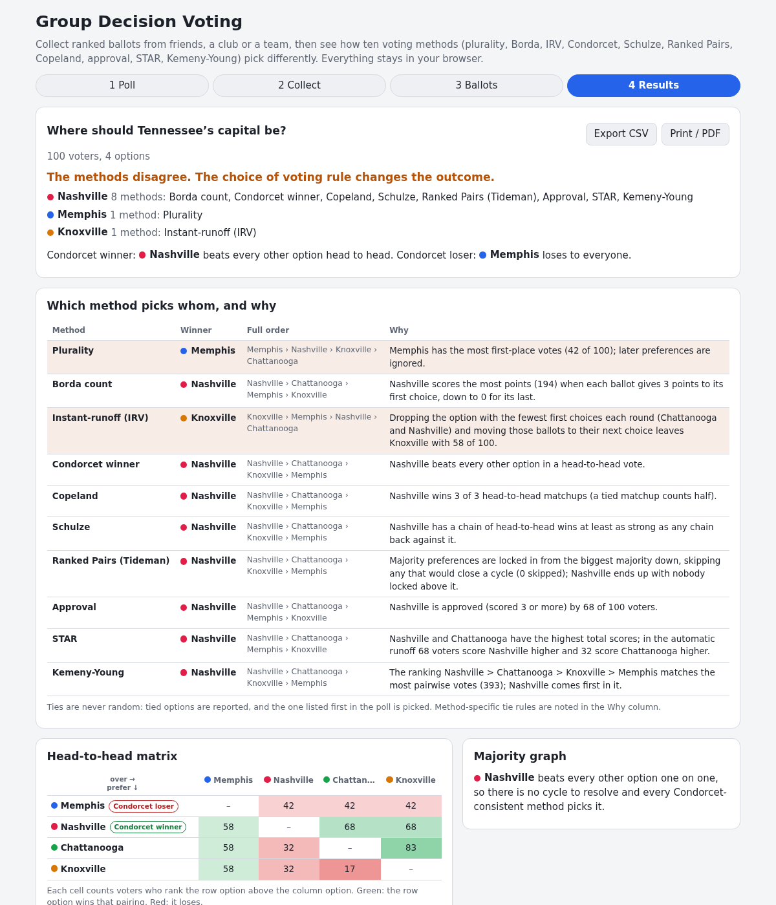

# Group Decision Voting

Decide as a group with ranked ballots. Create a poll, collect rankings by passing one phone around or by sharing a link (each voter sends back a short ballot code, no server involved), or import ballots from CSV. Then compare ten voting methods side by side: who each one picks, why, and where they disagree.

**Try it: [hermes98761234.github.io/group-decision-voting](https://hermes98761234.github.io/group-decision-voting/)**

[](https://github.com/hermes98761234/group-decision-voting/actions/workflows/deploy.yml)



## Features

- **Two ways to vote.** Pass-the-phone mode seals each ballot the moment it is cast and shows only a count until you close the box. Link mode puts the poll inside the URL; voters get a short (about 15-character) code (or link) to send back, and duplicates and ballots for another poll are rejected.
- **CSV import and export** of ballots: option names best first, with an optional count, or rank numbers per option.
- **Ten methods:** plurality, Borda, instant-runoff (with a round-by-round chart), Condorcet winner, Copeland, Schulze, Ranked Pairs, approval, STAR and Kemeny-Young (up to 8 options).
- **Comparison table** with a plain-language reason for every pick, highlighted disagreements, and a table of which method satisfies which criterion (Condorcet, Condorcet loser, majority, monotonicity, clone independence).
- **Condorcet analysis:** pairwise heatmap, Condorcet winner and loser, and the majority cycle drawn as a graph when there is a paradox.
- **Deterministic ties.** Ties are never random: they are reported, and broken in favour of the option listed first.
- **Presets:** the classic Tennessee capital, a Condorcet cycle, and pizza toppings. Light and dark theme, works at phone width, state kept in localStorage, results export to CSV or print.

## How it works

Every ballot is a full ranking plus a 0 to 5 score per option (default: spread evenly; scores of 3 or more count as approval). All ranked methods are computed from the pairwise matrix `p[i][j]`, the number of voters ranking i above j.

- **Schulze** (Schulze 2011): strongest-path widths by Floyd-Warshall; an option wins if no other has a stronger path against it. Checked against the 45-voter example in Wikipedia.
- **Ranked Pairs** (Tideman 1987): majorities sorted by size, each locked in unless it closes a cycle.
- **Kemeny-Young** (Kemeny 1959): exhaustive search for the ranking that agrees with the most pairwise votes.
- **IRV:** the option with fewest first choices is eliminated until one has a majority. **STAR:** the two highest total scores meet in a runoff decided by who scores higher on more ballots.
- **Ballot codes** are base64url: version and option count, ranking and score nibbles, a 16-bit poll fingerprint and a 24-bit ballot id.

Where a tie could change the winner (IRV eliminations, Ranked Pairs ordering), the app tries every rotation of the tie-break and flags the options that can win.

## Quick start

You need [Node.js](https://nodejs.org/) 22.

```bash
git clone https://github.com/hermes98761234/group-decision-voting.git
cd group-decision-voting
npm install
npm run dev       # http://localhost:5173
npm test          # voting methods, codec and CSV tests
npm run build     # static site in dist/
```

## License

MIT.
